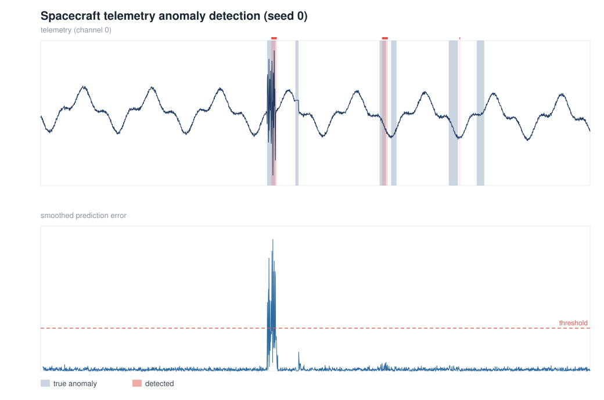

# Spacecraft Telemetry Anomaly Detection (NASA SMAP/MSL)

[](https://github.com/Harindi21/spacecraft-anomaly-detection/actions/workflows/ci.yml)

Unsupervised anomaly detection for multichannel spacecraft telemetry, modeled on
NASA JPL's **Telemanom** method (Hundman et al., *Detecting Spacecraft Anomalies
Using LSTMs and Nonparametric Dynamic Thresholding*, KDD 2018).

**Idea.** A model learns what each sensor *normally* does by predicting its next
values from a window of recent history. When reality drifts far from the
prediction, the **prediction error** spikes - that spike is the anomaly signal.
Instead of a hand-picked cutoff, each channel gets its own threshold chosen
automatically from the error distribution (**nonparametric dynamic
thresholding**), and borderline flagged sequences are pruned to limit false
alarms.

```
telemetry ─► forecaster (LSTM / AR) ─► prediction error ─► smooth
          ─► per-channel dynamic threshold ─► prune ─► anomaly flags ─► P/R/F1
```

## Run the demo now (NumPy only)

No dataset or GPU needed - it generates labelled synthetic telemetry with
injected anomalies and runs the whole pipeline:

```bash
pip install numpy pandas
python run_demo.py
```

It prints raw and point-adjusted precision/recall/F1 and writes `detection.svg`:



*Top: one telemetry channel, with ground-truth anomaly spans shaded grey and the
detector's flags in red. Bottom: the smoothed prediction error and its
automatically chosen threshold.*

## Run on the real NASA data

1. Download the SMAP/MSL benchmark (Kaggle):
   `patrickfleith/nasa-anomaly-detection-dataset-smap-msl`
   ```bash
   pip install -r requirements.txt
   kaggle datasets download -d patrickfleith/nasa-anomaly-detection-dataset-smap-msl
   unzip nasa-anomaly-detection-dataset-smap-msl.zip -d data/
   ```
   Expected layout: `data/train/<channel>.npy`, `data/test/<channel>.npy`,
   `data/labeled_anomalies.csv`.
2. Install TensorFlow for the LSTM forecaster (`pip install tensorflow`).
3. Run a channel:
   ```bash
   python main.py --data data --channel P-1 --model lstm
   ```

## Project layout

| File | Purpose |
|------|---------|
| `src/data.py` | Real SMAP/MSL loader + synthetic telemetry generator |
| `src/model.py` | `LSTMForecaster` (Keras) and dependency-free `ARForecaster` |
| `src/threshold.py` | Nonparametric dynamic thresholding + sequence pruning |
| `src/pipeline.py` | forecast → error → per-channel threshold → flags |
| `src/evaluate.py` | Precision / recall / F1 (raw and point-adjusted) |
| `src/plotting.py` | Dependency-free SVG renderer for detection figures |
| `run_demo.py` | End-to-end demo on synthetic data (writes `detection.svg`) |
| `main.py` | End-to-end run on the real benchmark |
| `tests/` | `pytest` suite covering every module |

## Tests

```bash
pip install -r requirements-dev.txt
pytest -q
```

The suite (24 tests) runs on NumPy alone and is exercised on every push by the
GitHub Actions workflow in `.github/workflows/ci.yml`.

## Notes

- The **LSTM** is the headline model and is used for the real data; the **AR**
  baseline exists so the pipeline runs instantly without TensorFlow (demo / CI).
- Metrics use **point adjustment**, the standard convention for time-series
  anomaly detection.
- This is a from-scratch reimplementation of the Telemanom *approach* for
  learning; it is not NASA's official code.
